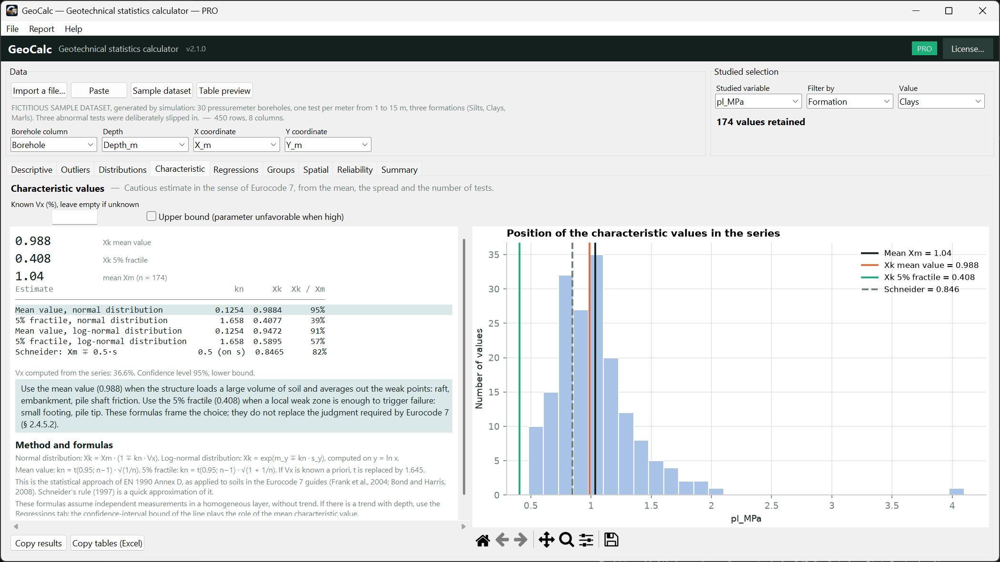
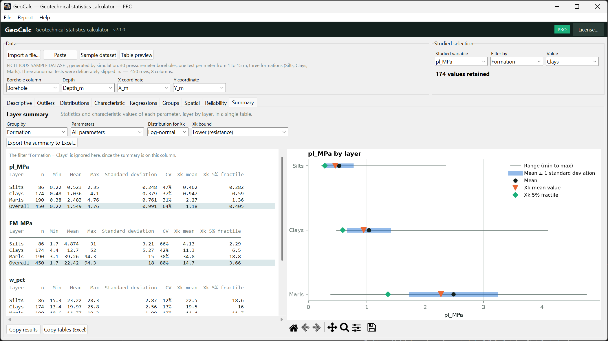
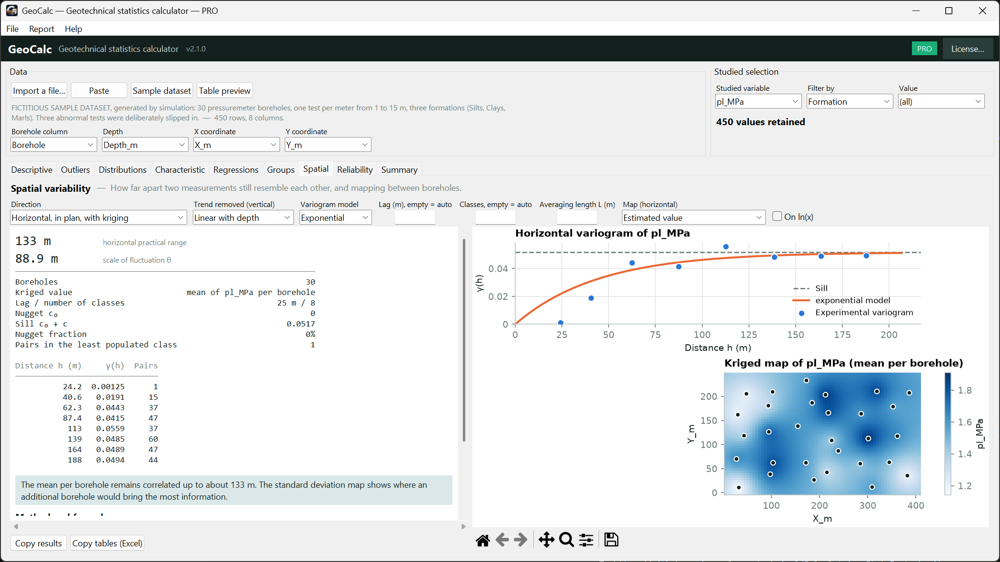

  

<a href="README.md">🇫🇷 Français</a> · 🇬🇧 English

# GeoCalc — statistics for geotechnical engineers

Analyse your soil test results without redoing the same calculations in a spreadsheet: outlier detection, distribution fitting, **Eurocode 7** characteristic values, regressions, and — in the PRO version — kriging, reliability analysis and ready-to-send reports.

**Windows 10 / 11 · no installation · works offline: your data never leaves your computer.**

> ### 🇬🇧 Now in English — and in French
> Since **version 2.1**, GeoCalc ships **both languages in the same program**: menus, results, explanations, charts and Word / PDF / Excel reports.
> It opens in the language of Windows; switch any time with **Help ▸ Langue / Language** — the software restarts and keeps your data.

👉 **[Download the latest version](../../releases/latest)**

## What GeoCalc does

| | Free | PRO |
|---|:---:|:---:|
| Import CSV / Excel / copy-paste from a spreadsheet (handles decimal commas, title rows, thousands separators) | ✅ | ✅ |
| Descriptive statistics and histograms | ✅ | ✅ |
| 4 outlier tests (Grubbs, Dixon, Chauvenet, IQR), one-click exclusion | ✅ | ✅ |
| Normal / log-normal fitting: Shapiro-Wilk, Lilliefors, Anderson-Darling, normal probability plots | ✅ | ✅ |
| **Eurocode 7** characteristic values (EN 1990 Annex D approach): mean-value and 5 % fractile | ✅ | ✅ |
| Regressions with confidence and prediction bands | ✅ | ✅ |
| Group comparison (ANOVA, Kruskal-Wallis, Levene, pairwise tests) | | ✅ |
| Spatial variability: variograms, scale of fluctuation, **kriging** | | ✅ |
| Reliability: FORM, Monte Carlo, Bayesian updating, ready-made limit-state models | | ✅ |
| **Layer summary**: every parameter, every formation, in one table | | ✅ |
| **Word, PDF and Excel** reports · saveable projects (.geostat) | | ✅ |

The free version has **no data limit**.

## Installation

1. Download the `.zip` archive from the [Releases](../../releases/latest) page.
2. **Extract it completely** (right-click ▸ "Extract all…"). Do not run the program from inside the zip.
3. Double-click `GeoCalc.exe`. It takes a few seconds to start.

> **Windows SmartScreen** may show "Windows protected your PC": the software is published by an independent developer and is not code-signed. Click "More info" then "Run anyway". You can check the file's integrity with the SHA-256 hash given in the release notes.

Click **Sample dataset** to try every tab immediately.

## Upgrading to PRO

1. In the software, click **Go PRO** (top right) and copy your **machine code**.
2. Send it to me: geocalc.geotechnical@gmail.com
3. Paste the key you receive into the activation window: PRO unlocks immediately.

Activation is **fully offline** (no server, no data sent). The key is personal and tied to your computer. PRO licence: €48.99. A 14-day trial is available on request.

## FAQ

**Is my data sent anywhere?** No. Everything is computed locally, and so is the activation.
**What if I change computer?** Send me the new machine code and I will issue a new key.
**Are the results guaranteed?** They are an aid to analysis: they depend on the quality of the data and on the assumptions made, and must be checked and interpreted by a qualified engineer.
**Which file formats?** CSV, TXT, TSV, Excel (.xlsx, .xlsm, .xls) and copy-paste from a spreadsheet.

## Licence and contact

Proprietary software, all rights reserved. The free version may be used free of charge, including for professional use; terms of use: on request at geocalc.geotechnical@gmail.com.
Contact: geocalc.geotechnical@gmail.com

*Screenshots use fictitious data.*

Need another language? French and English are available today; tell me which one you would need next: geocalc.geotechnical@gmail.com
