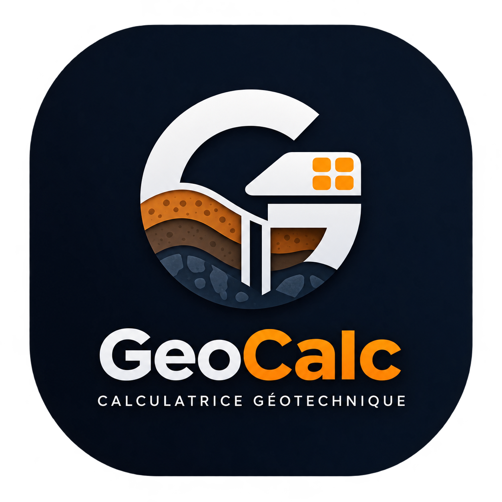
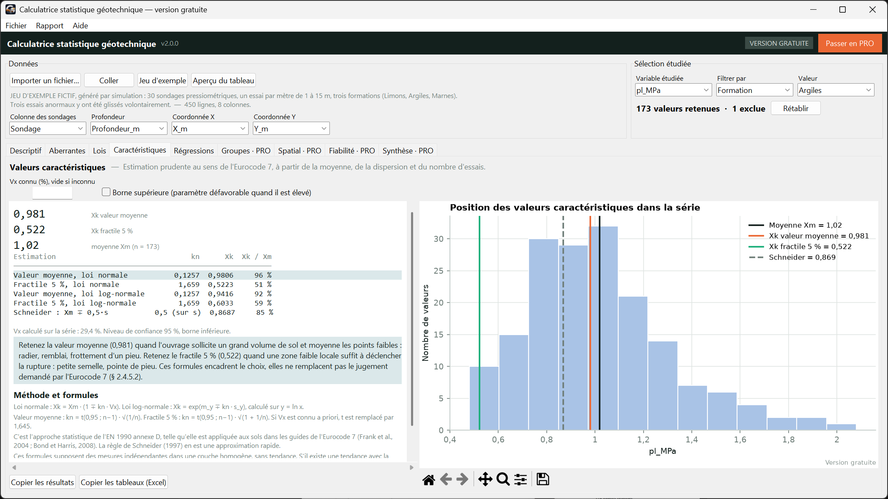
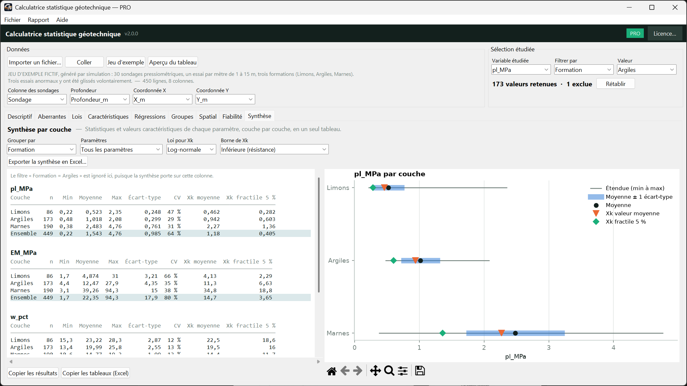
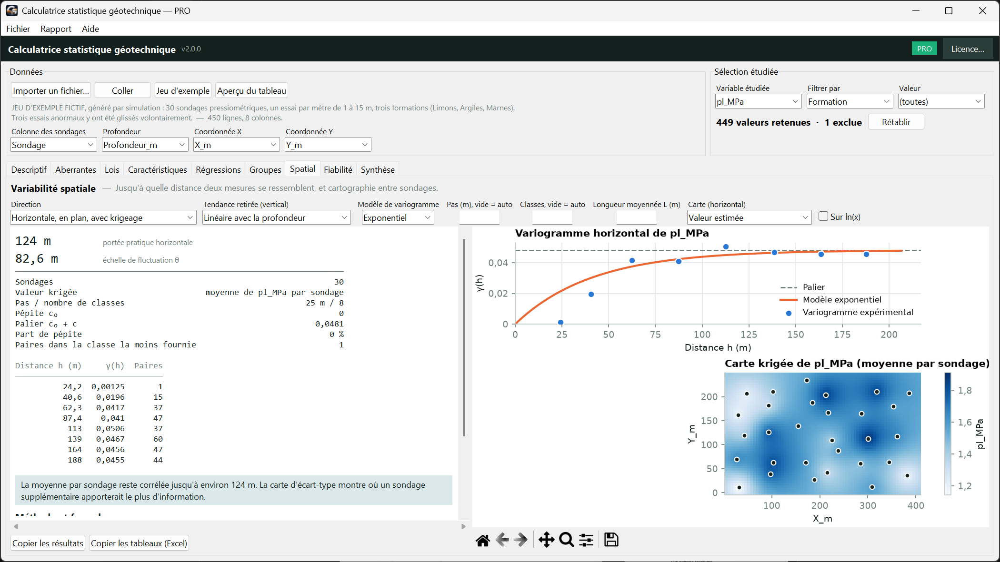

  

🇫🇷 Français · <a href="README.en.md">🇬🇧 English</a>

# GeoCalc — calculatrice statistique pour géotechniciens

Analysez vos essais de sol sans refaire les mêmes calculs dans un tableur : valeurs aberrantes, lois de distribution, valeurs caractéristiques de l'**Eurocode 7**, régressions, et en version PRO krigeage, fiabilité et rapports prêts à remettre.

**Windows 10 / 11 · aucune installation · fonctionne hors ligne : vos données ne quittent jamais votre ordinateur.**

🌍 **Deux langues dans le même programme : français et English** (menu Aide ▸ Langue / Language). Il s'ouvre dans la langue de Windows ; le changement garde vos données.

👉 **[Télécharger la version gratuite](../../releases/latest)**  

## Ce que fait GeoCalc

| | Gratuit | PRO |
|---|:---:|:---:|
| Import CSV / Excel / copier-coller (virgule ou point décimal, titres, milliers) | ✅ | ✅ |
| Statistiques descriptives et histogrammes | ✅ | ✅ |
| 4 tests de valeurs aberrantes (Grubbs, Dixon, Chauvenet, IQR), exclusion en un clic | ✅ | ✅ |
| Lois normale / log-normale : Shapiro-Wilk, Lilliefors, Anderson-Darling, droites de Henry | ✅ | ✅ |
| Valeurs caractéristiques **Eurocode 7** (EN 1990 annexe D) : valeur moyenne et fractile 5 % | ✅ | ✅ |
| Régressions avec bandes de confiance et de prévision | ✅ | ✅ |
| Comparaison de groupes (ANOVA, Kruskal-Wallis, Levene, tests deux à deux) | | ✅ |
| Variabilité spatiale : variogrammes, échelle de fluctuation, **krigeage** | | ✅ |
| Fiabilité : FORM, Monte-Carlo, actualisation bayésienne, modèles prêts à l'emploi | | ✅ |
| **Synthèse par couche** : tous les paramètres, toutes les formations, en un tableau | | ✅ |
| Rapports **Word, PDF et Excel** · projets enregistrables (.geostat) | | ✅ |

La version gratuite n'a **aucune limite de données**.

## Installation

1. Téléchargez l'archive `.zip` depuis la page [Releases](../../releases/latest).
2. **Décompressez-la entièrement** (clic droit ▸ « Extraire tout… »). Ne lancez pas le programme depuis l'intérieur du zip.
3. Double-cliquez sur `GeoCalc.exe`. Le démarrage prend quelques secondes.

> **Windows SmartScreen** peut afficher « Windows a protégé votre ordinateur » : le logiciel est diffusé par un éditeur indépendant et n'est pas signé. Cliquez sur « Informations complémentaires » puis « Exécuter quand même ». Vous pouvez vérifier l'intégrité du fichier avec l'empreinte SHA-256 indiquée dans les notes de version.

Cliquez sur **Jeu d'exemple** pour essayer chaque onglet immédiatement.

## Passer en PRO

1. Dans le logiciel : bouton **Passer en PRO** (en haut à droite). Copiez votre **code poste**.
2. Envoyez-le-moi : geocalc.geotechnical@gmail.com
3. Collez la clé reçue dans la fenêtre d'activation : la version PRO s'ouvre immédiatement.

L'activation se fait **hors ligne** (aucun serveur, aucune donnée envoyée). La clé est personnelle et liée à votre ordinateur. Licence PRO : 48,99 €. Essai de 14 jours possible sur demande.

## Questions fréquentes

**Mes données sont-elles envoyées quelque part ?** Non. Tout est calculé localement, l'activation aussi.
**Que se passe-t-il si je change d'ordinateur ?** Envoyez-moi le nouveau code poste, je vous fournis une nouvelle clé.
**Les résultats sont-ils garantis ?** Ce sont des aides à l'analyse : ils dépendent de la qualité des données et des hypothèses retenues, et doivent être vérifiés et interprétés par un ingénieur qualifié.
**Quels formats de fichiers ?** CSV, TXT, TSV, Excel (.xlsx, .xlsm, .xls) et copier-coller depuis un tableur.

## Licence et contact

Logiciel propriétaire, tous droits réservés. La version gratuite est utilisable gratuitement, y compris à titre professionnel ; conditions d'utilisation : sur demande à geocalc.geotechnical@gmail.com.
Contact : geocalc.geotechnical@gmail.com

*Les captures utilisent un jeu de données fictif.*
